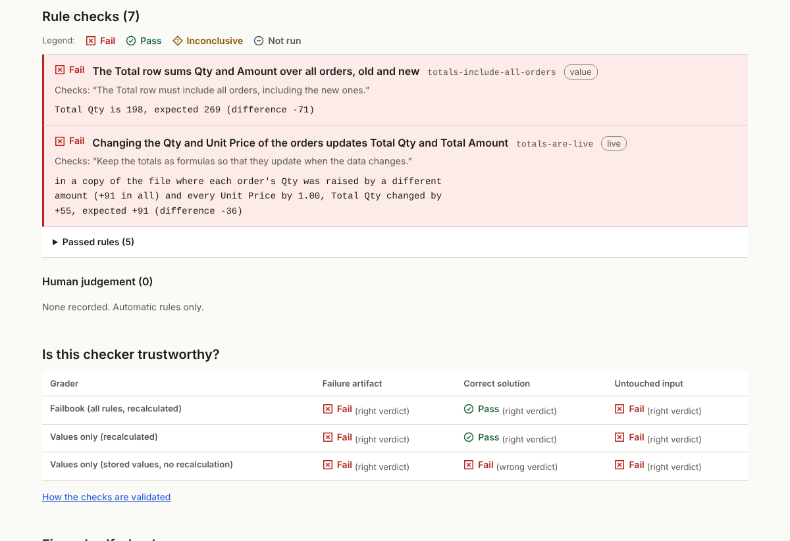

# Failbook

Reproducible cases where an AI agent said “done” and the spreadsheet was wrong, with checks anyone can rerun.

[中文说明](README.zh-CN.md) · [Case gallery](https://ray0766.github.io/failbook/) · [How the checks are validated](docs/evidence/checker-ablation.md)

> **Status: v0.1, first domain (spreadsheets), 15 cases.** Every case has inputs, a task, acceptance rules,
> a failure artifact and a validated checker. The failure artifacts are **reconstructions** produced by
> scripted naive steps, not recordings of a particular model, and **no agent retest results have been
> recorded yet**. See [docs/PROGRESS.md](docs/PROGRESS.md).

## What a case gives you

An evidence chain you can follow and rerun:

1. **Task and input**: a real-looking workbook and an instruction, in English and Chinese.
2. **Expected vs observed**: what a correct file looks like, and what the failure artifact actually contains.
3. **Rule-by-rule evidence**: every rule quotes the sentence of the task it checks, recalculates the workbook
   with LibreOffice, and fails with the exact cells and numbers (`Total Qty is 198, expected 269`).
4. **Reproduction without AI**: one command recreates the failure; another grades any agent's output.
5. **Fixes and retests**: remedies (an Agent Skill so far) and append-only run records.



## Quick start (no AI, no API key)

Needs Python 3.11+ and LibreOffice (`apt install libreoffice-calc`, `brew install --cask libreoffice`, or
the Windows installer).

```bash
git clone https://github.com/Ray0766/failbook && cd failbook
python3 -m venv .venv && . .venv/bin/activate && pip install -e .
failbook list
scripts/demo-evidence-chain.sh xlsx-001
```

The demo reproduces a failure, grades it, runs the fix's self-check on it, applies a correct solution and
grades again ([captured output](docs/evidence/demo-xlsx-001.md)).

## Why these checks

A plain "compare the recalculated numbers with the expected answer" check misses some of these failures,
and reading the numbers stored in the file instead of recalculating also rejects correct work. Failbook adds
**live** rules (change an input in a copy, recalculate, check that results follow), **preserve** rules (the
specific data and structures a case protects are unchanged) and **structure** rules (charts, validation,
formats). On the 15 failure artifacts ([full table](docs/evidence/checker-ablation.md)): <!-- sync-numbers -->

| Grader | Failures caught | Correct solutions accepted | Empty attempts caught |
|---|---|---|---|
| Failbook (all rules, recalculated) | 15 / 15 | 15 / 15 | 15 / 15 |
| Values only, recalculated | 11 / 15 | 15 / 15 | 15 / 15 |
| Values only, stored values (`openpyxl data_only=True`) | 11 / 15 | 3 / 15 | 15 / 15 |

The failures are Failbook's own reconstructions, chosen because they are subtle; these counts describe the
graders on this collection, not how often agents fail. Every checker is itself tested on three data variants:
the reference and alternative solutions must pass, also after LibreOffice re-saves them; the failure must fail
on the rules that explain it; the other wrong answers found in review (`fail_*.py`) must be graded fail; and an
untouched input must fail (`failbook verify --seeds 3`).

## Cases

<!-- cases:start -->
| ID | Observable failure | Difficulty | Caught by |
|---|---|---|---|
| [xlsx-001](cases/xlsx-001-total-misses-new-rows/) | New orders inserted above the Total row are left out of the total | easy | live, value |
| [xlsx-002](cases/xlsx-002-margin-hardcoded/) | A calculated column is pasted in as fixed numbers | easy | live |
| [xlsx-003](cases/xlsx-003-rate-reference-drifts/) | Filling a formula down shifts the reference to the tax-rate cell | easy | live, value |
| [xlsx-004](cases/xlsx-004-sort-scrambles-formulas/) | Sorting rows leaves each formula pointing at its old row | medium | live, value |
| [xlsx-005](cases/xlsx-005-insert-column-stale-refs/) | Inserting a column silently breaks formulas on another sheet | medium | live, value |
| [xlsx-006](cases/xlsx-006-rename-sheet-breaks-refs/) | Renaming a sheet breaks every formula that referred to it | easy | live, value |
| [xlsx-007](cases/xlsx-007-imported-text-numbers/) | Imported amounts and dates are stored as text, so totals ignore them | easy | content, value |
| [xlsx-008](cases/xlsx-008-percent-entered-as-whole-numbers/) | Percentages typed as whole numbers become 100 times too large | easy | content, value |
| [xlsx-009](cases/xlsx-009-lookup-approximate-match/) | A lookup without exact match returns another product's data | medium | value |
| [xlsx-010](cases/xlsx-010-grand-total-double-counts/) | A grand total sums the subtotals as well, counting everything twice | medium | live, value |
| [xlsx-011](cases/xlsx-011-chart-range-not-extended/) | New months are added, but the chart still stops at October | medium | structure |
| [xlsx-012](cases/xlsx-012-typo-fix-wipes-workbook/) | Fixing a typo with pandas wipes out the rest of the workbook | easy | no collateral damage, structure |
| [xlsx-013](cases/xlsx-013-dropdown-and-highlight-not-extended/) | New rows get no dropdown and no highlighting | medium | structure |
| [xlsx-014](cases/xlsx-014-delete-rows-shifts-formulas/) | Deleting rows leaves formulas pointing at the wrong rows | hard | live, value |
| [xlsx-015](cases/xlsx-015-summary-was-pasted-values/) | Data corrected, but the summary was pasted values and never updates | medium | value |
<!-- cases:end -->

## Retest an agent

```bash
# Any agent or app: prepare a fresh directory, let the agent work from TASK.md, then grade and record
failbook prepare xlsx-011 /tmp/try
failbook grade xlsx-011 /tmp/try --record results --agent <agent> --model <model>

# A CLI agent driven by Failbook (presets: claude-code, codex, gemini-cli, or --agent custom --cmd '...')
failbook run xlsx-011 --agent claude-code --model <model> --attempts 3

# Isolated in Docker with Harbor, which also powers NVIDIA SkillEvaluator's live evaluation
failbook export harbor --out dist/harbor
harbor run -p dist/harbor -a claude-code -m <model> -k 3
```

`failbook run` is **not a sandbox**: the agent runs unsandboxed as your user and can read and write the rest
of the file system. Its working directory is a fresh temporary directory outside the checkout (a `--runs-dir`
inside the checkout is refused), and on a timeout the whole process group is killed. Use Harbor for isolated,
comparable runs. `failbook grade` exits 0 on pass, 1 on fail, 3 when inconclusive and 4 when the grader could
not run. Submit every attempt as described in [results/README.md](results/README.md);
[RESULTS.md](RESULTS.md) shows passes / attempts per case, and deliberately no overall score or ranking.

## Fixes

[spreadsheet-verify-skill](fixes/spreadsheet-verify-skill/) is an Agent Skill: a checklist plus
`audit_xlsx.py`, a task-agnostic audit of an edited workbook against its original. The audit flags 13 of the
15 failure artifacts and raises no error on 30 correct solutions ([evidence](docs/evidence/fix-self-check.md)).
Whether agents do better with the skill is **not yet measured**; retest with `--fix spreadsheet-verify-skill`
or with SkillEvaluator (`failbook export skillevaluator --fix spreadsheet-verify-skill --out dist/se`).

## Repository

| Path | What |
|---|---|
| `cases/<id>/` | `case.yaml`, `task.md`, `task.zh.md`, `case.py` (data + rules), `reference.py`, `failure.py`, `input/`, `failure/` |
| `src/failbook/` | grader, LibreOffice engine, runner, Harbor/SkillEvaluator export, audit, docs and site generators |
| `fixes/`, `results/` | remedies to retest; append-only run records |
| `docs/` | [decisions](docs/DECISIONS.md), [datasheet](docs/DATASHEET.md), [failure taxonomy](docs/FAILURE_TAXONOMY.md), [writing cases](docs/WRITING_CASES.md), [evidence](docs/evidence/) |

## Limitations

- One domain, 15 curated cases: a collection of failure patterns, not a benchmark of agent reliability.
- All failure artifacts are reconstructed; none has been observed in a recorded agent run yet.
- Grading uses LibreOffice, not Excel. Functions it lacks are reported as inconclusive, not as failures;
  LibreOffice before 24.8 (Ubuntu 24.04 ships 24.2) cannot evaluate XLOOKUP.
- The data is synthetic and English-language.

## Feedback

Use GitHub Issues to share a concrete use case, expected workflow, or a small reproducible example. Please use synthetic or publicly shareable sample files. See [CONTRIBUTING.md](CONTRIBUTING.md).

## Agent guidance / 开发规范

Before implementation, read [AGENTS.md](AGENTS.md) and the [project quality brief](docs/QUALITY_BRIEF.md) for research, differentiation, design references, and acceptance criteria.

后续 Agent 开发前，请先阅读上述工作规范与项目 brief；先验证技术选择和核心亮点，再完成设计、实现与验收。

## License

MIT. All case data is synthetic.
