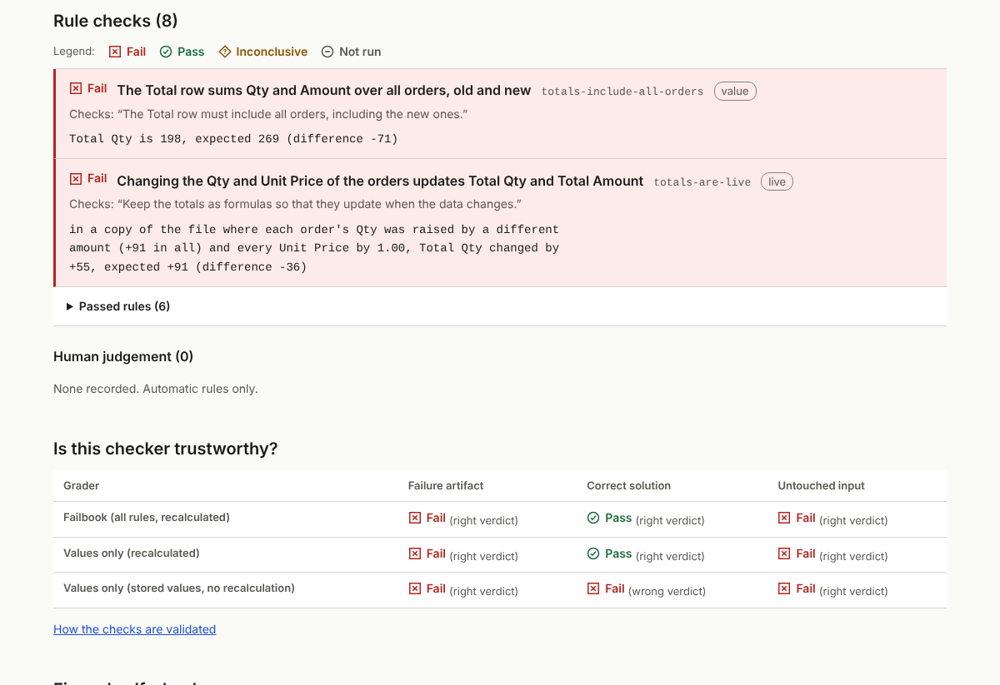

# Failbook

可复现的 AI 翻车案例库：智能体说“完成了”，表格却是错的；附带任何人都能重跑的验收检查。

[English](README.md) · [案例展示页](https://ray0766.github.io/failbook/zh/) · [检查器如何被验证](docs/evidence/checker-ablation.md)

> **状态：v0.1，首个领域（电子表格），15 个案例。** 每个案例都有输入、任务、验收规则、失败产物和经过验证的检查器。
> 失败产物是用脚本执行朴素步骤得到的**复现品**，不是某个模型的运行记录；**目前还没有任何智能体的复测结果**。
> 详见 [docs/PROGRESS.md](docs/PROGRESS.md)。

## 一个案例提供什么

一条可以跟随、可以重跑的证据链：

1. **任务与输入**：一个逼真的工作簿和一段中英文任务说明。
2. **预期与实测**：正确的文件应该是什么样，失败产物里实际是什么。
3. **逐条规则证据**：每条规则都对应任务中的一句话，用 LibreOffice 重新计算工作簿，失败时给出具体单元格和数字（如 `Total Qty is 198, expected 269`）。
4. **不依赖 AI 的复现**：一条命令重现失败，另一条命令给任意智能体的输出评分。
5. **修复与复测**：修复方案（目前是一个 Agent Skill）和只追加的运行记录。



## 快速开始（不需要 AI，不需要 API 密钥）

需要 Python 3.11+ 和 LibreOffice（`apt install libreoffice-calc`、`brew install --cask libreoffice` 或 Windows 安装包）。

```bash
git clone https://github.com/Ray0766/failbook && cd failbook
python3 -m venv .venv && . .venv/bin/activate && pip install -e .
failbook list --lang zh
scripts/demo-evidence-chain.sh xlsx-001
```

演示脚本会复现一个失败、给它评分、运行修复方案的自检、应用正确解法并再次评分（[输出记录](docs/evidence/demo-xlsx-001.md)）。

## 为什么要这样检查

只做“把重新计算后的数字和预期答案对一下”的检查，会漏掉其中一部分失败；而直接读取文件里缓存的数字、不重新计算，还会把正确的结果判错。Failbook 增加了**实时性**规则（在副本中修改某个输入、重新计算，检查结果是否跟着变）、**无连带破坏**规则（案例要保护的具体数据和结构没有被改动）和**结构**规则（图表、数据验证、格式）。在 15 个失败产物上（[完整表格](docs/evidence/checker-ablation.md)）：<!-- sync-numbers -->

| 评分器 | 抓到的失败 | 接受的正确解 | 抓到的空操作 |
|---|---|---|---|
| Failbook（全部规则，重新计算） | 15 / 15 | 15 / 15 | 15 / 15 |
| 只查数值（重新计算） | 11 / 15 | 15 / 15 | 15 / 15 |
| 只查数值（读文件缓存值，`openpyxl data_only=True`） | 11 / 15 | 3 / 15 | 15 / 15 |

这些失败是 Failbook 自己复现的，专门挑选了隐蔽的模式；这些数字描述的是评分器在本案例集上的表现，不代表智能体犯错的频率。每个检查器本身都在三个数据变体上接受检验：参考解与替代解法必须通过，经 LibreOffice 重新保存后也要通过；失败产物必须在解释它的规则上失败；复核中发现的其他错误答案（`fail_*.py`）必须被判不通过；原样交回的输入必须失败（`failbook verify --seeds 3`）。

## 案例

<!-- cases:start -->
| 编号 | 可观察到的失败 | 难度 | 失败产物被哪些规则抓到 |
|---|---|---|---|
| [xlsx-001](cases/xlsx-001-total-misses-new-rows/) | 在合计行上方插入新订单后，合计没有包含新订单 | easy | 实时性, 数值 |
| [xlsx-002](cases/xlsx-002-margin-hardcoded/) | 计算列被写成了固定数值，而不是公式 | easy | 实时性 |
| [xlsx-003](cases/xlsx-003-rate-reference-drifts/) | 向下填充公式时，指向税率单元格的引用跟着偏移了 | easy | 实时性, 数值 |
| [xlsx-004](cases/xlsx-004-sort-scrambles-formulas/) | 排序后，每个公式仍指向原来的行 | medium | 实时性, 数值 |
| [xlsx-005](cases/xlsx-005-insert-column-stale-refs/) | 插入一列后，另一张工作表上的公式悄悄错位 | medium | 实时性, 数值 |
| [xlsx-006](cases/xlsx-006-rename-sheet-breaks-refs/) | 重命名工作表后，所有引用它的公式都失效了 | easy | 实时性, 数值 |
| [xlsx-007](cases/xlsx-007-imported-text-numbers/) | 导入的金额和日期被存成文本，汇总公式直接忽略了它们 | easy | 内容, 数值, 结构 |
| [xlsx-008](cases/xlsx-008-percent-entered-as-whole-numbers/) | 百分比按整数录入，结果放大了 100 倍 | easy | 内容, 数值 |
| [xlsx-009](cases/xlsx-009-lookup-approximate-match/) | 查找公式没有使用精确匹配，返回了别的产品的数据 | medium | 数值 |
| [xlsx-010](cases/xlsx-010-grand-total-double-counts/) | 总计把小计也一起加了进去，所有数字都算了两遍 | medium | 实时性, 数值 |
| [xlsx-011](cases/xlsx-011-chart-range-not-extended/) | 新月份数据加上了，图表却仍停在 10 月 | medium | 结构 |
| [xlsx-012](cases/xlsx-012-typo-fix-wipes-workbook/) | 用 pandas 改一个错字，却毁掉了工作簿的其余部分 | easy | 无连带破坏, 结构 |
| [xlsx-013](cases/xlsx-013-dropdown-and-highlight-not-extended/) | 新增的行既没有下拉列表，也没有高亮规则 | medium | 结构 |
| [xlsx-014](cases/xlsx-014-delete-rows-shifts-formulas/) | 删除行之后，公式指向了错误的行 | hard | 实时性, 数值 |
| [xlsx-015](cases/xlsx-015-summary-was-pasted-values/) | 数据改对了，但汇总表是粘贴的静态数值，根本不会更新 | medium | 数值 |
<!-- cases:end -->

## 复测一个智能体

```bash
# 任意智能体或应用：准备新目录，让智能体按 TASK.md 工作，然后评分并记录
failbook prepare xlsx-011 /tmp/try --lang zh
failbook grade xlsx-011 /tmp/try --record results --agent <agent> --model <model> --lang zh

# 由 Failbook 驱动命令行智能体（预设：claude-code、codex、gemini-cli，或 --agent custom --cmd '...'）
failbook run xlsx-011 --agent claude-code --model <model> --attempts 3

# 用 Harbor 在 Docker 中隔离运行（NVIDIA SkillEvaluator 的实时评测也基于它）
failbook export harbor --out dist/harbor
harbor run -p dist/harbor -a claude-code -m <model> -k 3
```

`failbook run` **不是沙箱**：智能体以你的用户身份、在没有隔离的情况下运行，可以读写文件系统的其他部分。它的工作目录是检出目录之外新建的临时目录（拒绝使用检出目录内的 `--runs-dir`），超时时会终止整个进程组。需要隔离、可比较的运行时请用 Harbor。`failbook grade` 的退出码：0 通过，1 不通过，3 无法判定，4 评分器无法运行。请按 [results/README.md](results/README.md) 提交每一次尝试；[RESULTS.md](RESULTS.md) 只显示每个案例的通过次数/尝试次数，刻意不给总分或排名。

## 修复方案

[spreadsheet-verify-skill](fixes/spreadsheet-verify-skill/) 是一个 Agent Skill：一份检查清单，加上 `audit_xlsx.py`——把改动后的工作簿与原件对比、与具体任务无关的审计脚本。它能标记 15 个失败产物中的 13 个，对 41 个正确解没有报出任何错误（[证据](docs/evidence/fix-self-check.md)）。智能体用了这个 Skill 是否真的做得更好，**尚未测量**；可以用 `--fix spreadsheet-verify-skill` 或 SkillEvaluator（`failbook export skillevaluator --fix spreadsheet-verify-skill --out dist/se`）复测。

## 仓库结构

| 路径 | 内容 |
|---|---|
| `cases/<id>/` | `case.yaml`、`task.md`、`task.zh.md`、`case.py`（数据与规则）、`reference.py`、`failure.py`、`input/`、`failure/` |
| `src/failbook/` | 评分器、LibreOffice 引擎、运行器、Harbor/SkillEvaluator 导出、审计、文档与站点生成 |
| `fixes/`、`results/` | 可复测的修复方案；只追加的运行记录 |
| `docs/` | [决策记录](docs/DECISIONS.md)、[数据集说明](docs/DATASHEET.md)、[失败分类](docs/FAILURE_TAXONOMY.md)、[编写案例](docs/WRITING_CASES.md)、[证据](docs/evidence/) |

## 限制

- 只有一个领域、15 个精选案例：这是失败模式的集合，不是智能体可靠性的基准。
- 所有失败产物都是复现品，还没有在真实运行记录中观察到。
- 评分使用 LibreOffice 而不是 Excel。它不支持的函数会判为“无法判定”，不算失败；LibreOffice 24.8 之前的版本（Ubuntu 24.04 自带 24.2）无法计算 XLOOKUP。
- 数据是合成的，并且是英文内容。

## 反馈

欢迎通过 Issues 提供具体使用场景、期望流程或可复现样例。请使用虚构或可公开分享的样例文件。参见 [CONTRIBUTING.md](CONTRIBUTING.md)。

## 开发规范

后续 Agent 开发前，请先阅读 [AGENTS.md](AGENTS.md) 与[项目质量 brief](docs/QUALITY_BRIEF.md)；先验证技术选择和核心亮点，再完成设计、实现与验收。

## 许可

MIT。所有案例数据均为合成数据。
